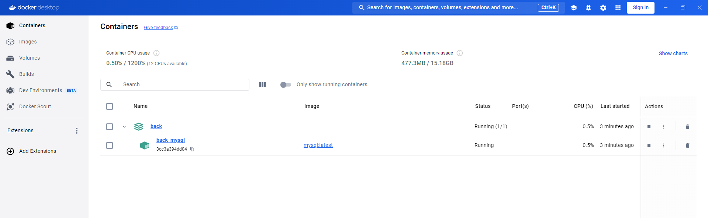

# Yoga App !

Backend de l'application Yoga App !.


## Configuration du back

    - name: back
    - port: 8080

## Pré-requis pour le bon fonctionnement du back :

    -> JDK 21
    -> Docker
    -> Docker Compose
    -> Maven 3.9.3 (https://archive.apache.org/dist/maven/maven-3/3.9.3/binaries/) ou plus

### Utiliser les versions du sujet avec mise

Avec `mise` installé, exécuter depuis `backend/` :

```bash
mise install java@21 maven@3.9.3
mise exec java@21 maven@3.9.3 -- mvn -version
mise exec java@21 maven@3.9.3 -- mvn -B clean verify
```

Ces commandes utilisent Java 21 et Maven 3.9.3 sans changer le Java du système.
`verify` exécute les tests HTTP avec Spring Security, JWT, JPA et une base H2
isolée, ainsi que les tests de validation des jetons et de mapping. Ces tests
ne nécessitent pas Docker et ne modifient pas MySQL. JaCoCo 0.8.12, compatible
Java 21, impose le seuil existant de 90 % des lignes par package ; le rapport
est disponible dans `target/site/jacoco/index.html`.

Les résultats JUnit sont dans `target/surefire-reports/`. H2 ne remplace pas
une validation avec MySQL : vérifier séparément les contraintes SQL et les
parcours contre le serveur réel.

### Tests avec le MySQL existant

Pour compléter H2, relever le port de MySQL comme décrit plus bas et exécuter
depuis `backend/`, avec les identifiants du fichier `.env` existant :

```bash
YOGA_MYSQL_TEST_URL=jdbc:mysql://127.0.0.1:32768/test mise exec java@21 maven@3.9.3 -- mvn -B clean verify
```

Remplacer l’URL par celle de la base Yoga visée. `MySqlPersistenceTest` utilise
uniquement `ddl-auto=validate` et ses propres fixtures transactionnelles annulées
en fin de test ; aucune table ni volume n’est recréé. Les compteurs automatiques
peuvent avancer malgré le rollback. Sans cette variable, ces tests MySQL sont
explicitement ignorés, tandis que les tests H2 restent exécutés. Ces tests
vérifient suppression d’un compte inscrit, maintien des participants à l’édition,
clés étrangères, unicité des adresses et unicité de la séance par enseignant.
Les essais HTTP sur serveur et les parcours navigateur sont des vérifications
complémentaires.

## Partie 2 — tests unitaires et intégration

La commande complète `mise exec java@21 maven@3.9.3 -- mvn -B clean verify`
exécute JUnit 5 / Mockito et les intégrations Spring Boot Test avec H2. Pour
inclure MySQL, utiliser la variable `YOGA_MYSQL_TEST_URL` présentée ci-dessus.
Les tests MySQL utilisent la base existante en `validate` et annulent leurs
fixtures ; les tests H2 créent uniquement une base en mémoire isolée.

| Périmètre | Tests et scénarios |
| --- | --- |
| Unitaire B-U01 | AuthServiceTest : inscription non admin, hachage via encodeur, doublon sans écriture, rôle persistant, mauvais identifiants sans JWT. |
| Unitaire B-U02 | TeacherServiceTest : liste, absence et recherches obligatoire/facultative. |
| Unitaire B-U03 | SessionServiceTest : édition sans perte de membres, ressource absente, inscription en doublon, retrait préservant les autres membres. |
| Unitaire B-U04 | UserServiceTest et ServiceResponsibilitiesTest : propriété, existence, suppression des seules inscriptions avant le compte. |
| Intégration B-I01 | ApiContractsTest (`@Tag("integration")`) : les quatre contrôleurs via MockMvc, vraie chaîne Spring Security/JWT, services, mappers et JPA/H2. |
| Intégration B-I02 | MySqlPersistenceTest (`@Tag("integration")`) : clés étrangères, unicités, édition et suppression de compte inscrit avec relecture persistée. |

Les tests Mockito isolent les repositories et les collaborateurs externes ;
les tests d’intégration utilisent le contexte `@SpringBootTest`, pas un mock
de service. Les DTO ne font pas l’objet de tests dédiés : `dto/**` et `payload/**`
sont exclus de JaCoCo conformément au périmètre demandé. Les DTO peuvent servir
de données d’entrée aux tests de contrat sans tester leurs accesseurs.
`lombok.config` marque le code généré par Lombok ; JaCoCo filtre ce code généré,
mais conserve le code écrit à la main, les services, la sécurité et les mappers.

JaCoCo échoue sous 80 % pour **instructions, branches, complexité, méthodes et
classes**, par package, et conserve le seuil existant de **90 % des lignes**.
Aucun contrôle d’architecture n’est désactivé. Rapports :
`target/site/jacoco/index.html`, `target/site/jacoco/jacoco.xml` et
`target/surefire-reports/TEST-*.xml`.

Pour sélectionner les intégrations seules :

```bash
mise exec java@21 maven@3.9.3 -- mvn -B -Dgroups=integration test
```

Cette sélection ne remplace pas `verify`, qui mesure la suite complète.
La proportion d’intégration se calcule sur les cas exécutés, en excluant les
cas ignorés : somme des attributs `tests - skipped` des deux suites annotées,
divisée par la même somme de toutes les suites XML. La dernière exécution H2
compte 34 intégrations sur 63 tests exécutés (53,97 %). MySQL ajoute cinq cas
d’intégration quand sa variable est renseignée. Les fichiers XML permettent de
recalculer ce ratio après chaque évolution ; le minimum demandé est 30 %.
La vérification complète avec MySQL a passé **68 tests, dont 39 intégrations
(57,35 %)**, sans échec ni test ignoré. Les couvertures globales mesurées sont :
98,58 % instructions, 95,24 % branches, 98,29 % lignes, 96 % complexité,
98,15 % méthodes et 100 % classes. Les seuils sont contrôlés par package ;
les rapports XML/HTML précisent les dénominateurs et le périmètre exclu.

La grille d’évaluation fournie couvre tests unitaires/intégration, proportion,
rapports multi-indicateurs et procédures README. La matrice ci-dessus relie
ces critères aux classes réellement exécutées.

## Responsabilités et erreurs HTTP

Les contrôleurs délèguent les opérations métier aux services. `AuthService`
assure la connexion et l’inscription ; les services vérifient l’existence des
ressources avant lecture ou suppression et la propriété du compte avant sa
suppression. `ArchitectureTest` interdit toute dépendance des contrôleurs vers
les repositories.

`ApiExceptionHandler` traite les identifiants non numériques et les opérations
de participation invalides en 400, les ressources absentes en 404 et le refus
de suppression du compte d’un autre utilisateur en 401, conformément au contrat
existant. Ces réponses ont un corps vide. Les messages JSON d’inscription et
la réponse de connexion sont conservés. Les opérations cohérentes de suppression
et de participation sont transactionnelles.

La modification d’une séance charge d’abord la séance existante et change
uniquement son nom, sa description, sa date et son enseignant. Elle conserve
les participants et la date de création ; les inscriptions passent par les
routes de participation. Une séance absente renvoie 404, sans tentative de sauvegarde.

Les corps JSON illisibles et les erreurs de validation renvoient 400 avec un
corps vide. Une référence d’enseignant ou de participant inexistante renvoie
404. Une violation de contrainte SQL résiduelle renvoie 409, sans exposer la
requête SQL ni les valeurs concernées. Le doublon d’adresse détecté lors de
l’inscription conserve son message JSON 400 ; une course d’insertion est un
conflit 409.

### Autorisations

La création, la modification et la suppression de séances exigent le rôle
`ADMIN` dans `SessionService`. Les autorités sont rechargées depuis la base à
chaque requête authentifiée : un rôle fourni par le client ne donne aucun droit.
Les lectures restent accessibles aux utilisateurs connectés. Les routes de
participation et de désinscription exigent que l’identifiant utilisateur de
l’URL corresponde à celui de l’identité authentifiée, y compris pour un admin.

Un appel anonyme reçoit 401 ; une opération interdite à un utilisateur connecté
reçoit 403 avec un corps vide. Le refus de suppression du compte d’un tiers
conserve son contrat historique 401.

### Une seule séance par enseignant

Un enseignant peut être affecté à une seule séance. Le mapping `@OneToOne` et
l’index unique sur `sessions.teacher_id` sont conservés. Créer une seconde séance
pour le même enseignant, ou lui réaffecter une autre séance, produit un conflit
409 avec un corps vide. Modifier la séance actuelle en conservant son enseignant
reste possible. Aucun changement de schéma ou de données n’est nécessaire.

### Journalisation

La création d’une séance journalise uniquement son identifiant. Les empreintes
de mot de passe sont exclues de `User.toString()` et les participants sont
exclus de `Session.toString()`. Un test capture les logs avec des marqueurs
synthétiques pour vérifier l’absence d’informations sensibles.

### Suppression d’un compte inscrit

La suppression de son propre compte retire ses inscriptions de toutes les
séances, puis supprime le compte dans la même transaction. Les séances,
enseignants et inscriptions des autres membres sont conservés. Aucun effacement
en cascade des séances n’est configuré ; les clés étrangères restent actives.

## Validation locale du 13 novembre 2026

Résultats de la reprise du code avant la partie 2 ; les nouveaux seuils et
résultats de tests sont présentés dans la section Partie 2 ci-dessus.

| Contrôle | Résultat |
| --- | --- |
| `clean verify` avec Java 21 / Maven 3.9.3 via mise et URL MySQL | 48 tests réussis, dont cinq sur MySQL ; aucun test ignoré. |
| JaCoCo | Seuil existant de 90 % des lignes par package respecté. |
| Contrats HTTP contre le JAR et MySQL | 49 contrôles réussis : autorisations, statuts, édition, inscriptions et suppression de compte inscrit. |
| Parcours Chromium contre Angular / Spring / MySQL | 13 contrôles réussis ; données temporaires retirées et lignes initiales identiques. |
| Frontend conservé, vérifié dans une copie isolée | 48 tests / 14 suites, lint et builds de développement et production réussis. |

Le build de production émet l’avertissement de budget initial : 843,19 kB pour
un seuil d’avertissement de 500 kB ; le plafond bloquant de 1 MB est respecté.
L’optimisation des polices nécessite l’accès réseau à Google Fonts.

Le frontend reste inchangé à la demande de l’utilisateur. Ses validations de
longueur et son champ de mot de passe d’inscription restent ceux du starter.
Login/Register affichent une erreur générique ; le formulaire de séance ne
présente pas de message dédié pour un refus 409. Ces limites ont été vérifiées
dans Chromium ; les statuts et les contrôles côté serveur sont opérationnels.
La validation locale du backend est acquise. La validation complète de
l’expérience utilisateur conserve ces réserves. Aucun push, merge ou déploiement
n’est inclus dans cette validation.

## Démarrage du back
Pour démarrer le back, il :
- démarrer Docker-Desktop sur votre poste de travail local.
- lancer une console, se placer dans `backend/` et exécuter la commande Maven avec `mise` :
```
mise exec java@21 maven@3.9.3 -- mvn spring-boot:run
```
Cette commande va :
- initialiser le container Docker qui contient la base de données
- lancer l'application back et le connecter à la base de données précédemment créée

### Si les ports habituels sont occupés

Conserver les autres applications et volumes existants. Depuis la racine du
dépôt, démarrer uniquement le MySQL de ce starter et relever son port hôte :

```bash
docker compose --project-directory backend --env-file backend/.env -f backend/compose.yaml config --quiet
docker compose --project-directory backend --env-file backend/.env -f backend/compose.yaml up -d mysql
docker compose --project-directory backend --env-file backend/.env -f backend/compose.yaml port mysql 3306
```

L’accès au socket peut nécessiter les droits Docker de votre environnement.
Ne pas modifier ses permissions pour contourner un refus. Conserver le projet
Compose `backend`, le conteneur `back_mysql` et le volume `backend_db_data`.

Depuis `backend/`, lancer Spring sur un port libre, ici 8082. Dans cet exemple,
remplacer **32768** par le port MySQL relevé, attribué dynamiquement :

```bash
mise exec java@21 maven@3.9.3 -- mvn -B spring-boot:run -Dspring-boot.run.arguments='--server.port=8082 --spring.docker.compose.enabled=false --spring.datasource.url=jdbc:mysql://127.0.0.1:32768/test'
```

L’intégration Compose de Spring est désactivée pour cette exécution parce que
MySQL a déjà été lancé séparément. Les identifiants restent chargés depuis
`backend/.env`. Examiner la cible avant de démarrer : la configuration Hibernate
du starter utilise `ddl-auto: update`.

Pour le frontend, le proxy doit viser le port choisi pour Spring. Sans modifier
la configuration du starter, créer un fichier temporaire hors du dépôt, par
exemple `/tmp/yoga-proxy.json`, contenant :

```json
{
  "/api": {
    "target": "http://127.0.0.1:8082",
    "secure": false,
    "changeOrigin": true,
    "logLevel": "debug"
  }
}
```

Depuis `frontend/`, avec les dépendances installées, lancer Angular sur un
autre port libre :

```bash
npm start -- --host 127.0.0.1 --port 4202 --proxy-config /tmp/yoga-proxy.json
```

Consulter ensuite `http://127.0.0.1:4202`. Une compilation réussie ne suffit
pas : vérifier les requêtes du proxy et les parcours avec la base réelle.
Ne pas supprimer de volume pour résoudre un échec de démarrage.

### Exemple de traces de démarrage

Les traces logs devraient ressemblées à ceci :
```
  .   ____          _            __ _ _
 /\\ / ___'_ __ _ _(_)_ __  __ _ \ \ \ \
( ( )\___ | '_ | '_| | '_ \/ _` | \ \ \ \
 \\/  ___)| |_)| | | | | || (_| |  ) ) ) )
  '  |____| .__|_| |_|_| |_\__, | / / / /
 =========|_|==============|___/=/_/_/_/

 :: Spring Boot ::                (v3.5.5)

[back] [           main] c.o.s.SpringBootSecurityJwtApplication   : Starting SpringBootSecurityJwtApplication using Java 21.0.3 with PID 15152
[back] [           main] c.o.s.SpringBootSecurityJwtApplication   : No active profile set, falling back to 1 default profile: "default"
[back] [           main] .s.b.d.c.l.DockerComposeLifecycleManager : Using Docker Compose file E:\dev\workspaces\missionOC\projet-p4\back\compose.yaml
[back] [utReader-stderr] o.s.boot.docker.compose.core.DockerCli   :  Container back_mysql  Created
[back] [utReader-stderr] o.s.boot.docker.compose.core.DockerCli   :  Container back_mysql  Starting
[back] [utReader-stderr] o.s.boot.docker.compose.core.DockerCli   :  Container back_mysql  Started
[back] [utReader-stderr] o.s.boot.docker.compose.core.DockerCli   :  Container back_mysql  Waiting
[back] [utReader-stderr] o.s.boot.docker.compose.core.DockerCli   :  Container back_mysql  Healthy
[back] [           main] .s.d.r.c.RepositoryConfigurationDelegate : Bootstrapping Spring Data JPA repositories in DEFAULT mode.
[back] [           main] .s.d.r.c.RepositoryConfigurationDelegate : Finished Spring Data repository scanning in 58 ms. Found 3 JPA repository interfaces.
[back] [           main] o.s.b.w.embedded.tomcat.TomcatWebServer  : Tomcat initialized with port 8080 (http)
[back] [           main] o.apache.catalina.core.StandardService   : Starting service [Tomcat]
[back] [           main] o.apache.catalina.core.StandardEngine    : Starting Servlet engine: [Apache Tomcat/10.1.44]
[back] [           main] o.a.c.c.C.[Tomcat].[localhost].[/]       : Initializing Spring embedded WebApplicationContext
[back] [           main] w.s.c.ServletWebServerApplicationContext : Root WebApplicationContext: initialization completed in 1360 ms
[back] [           main] o.hibernate.jpa.internal.util.LogHelper  : HHH000204: Processing PersistenceUnitInfo [name: default]
[back] [           main] org.hibernate.Version                    : HHH000412: Hibernate ORM core version 6.6.26.Final
[back] [           main] o.h.c.internal.RegionFactoryInitiator    : HHH000026: Second-level cache disabled
[back] [           main] o.s.o.j.p.SpringPersistenceUnitInfo      : No LoadTimeWeaver setup: ignoring JPA class transformer
[back] [           main] com.zaxxer.hikari.HikariDataSource       : HikariPool-1 - Starting...
[back] [           main] com.zaxxer.hikari.pool.HikariPool        : HikariPool-1 - Added connection com.mysql.cj.jdbc.ConnectionImpl@16cb6f51
[back] [           main] com.zaxxer.hikari.HikariDataSource       : HikariPool-1 - Start completed.
[back] [           main] org.hibernate.orm.connections.pooling    : HHH10001005: Database info:
	Database JDBC URL [Connecting through datasource 'HikariDataSource (HikariPool-1)']
	Database driver: undefined/unknown
	Database version: 9.1
	Autocommit mode: undefined/unknown
	Isolation level: undefined/unknown
	Minimum pool size: undefined/unknown
	Maximum pool size: undefined/unknown
[back] [           main] o.h.e.t.j.p.i.JtaPlatformInitiator       : HHH000489: No JTA platform available (set 'hibernate.transaction.jta.platform' to enable JTA platform integration)
[back] [           main] j.LocalContainerEntityManagerFactoryBean : Initialized JPA EntityManagerFactory for persistence unit 'default'
[back] [           main] eAuthenticationProviderManagerConfigurer : Global AuthenticationManager configured with AuthenticationProvider bean with name authenticationProvider
[back] [           main] r$InitializeUserDetailsManagerConfigurer : Global AuthenticationManager configured with an AuthenticationProvider bean. UserDetailsService beans will not be used by Spring Security for automatically configuring username/password login. Consider removing the AuthenticationProvider bean. Alternatively, consider using the UserDetailsService in a manually instantiated DaoAuthenticationProvider. If the current configuration is intentional, to turn off this warning, increase the logging level of 'org.springframework.security.config.annotation.authentication.configuration.InitializeUserDetailsBeanManagerConfigurer' to ERROR
[back] [           main] JpaBaseConfiguration$JpaWebConfiguration : spring.jpa.open-in-view is enabled by default. Therefore, database queries may be performed during view rendering. Explicitly configure spring.jpa.open-in-view to disable this warning
[back] [           main] o.s.b.w.embedded.tomcat.TomcatWebServer  : Tomcat started on port 8080 (http) with context path '/'
[back] [           main] c.o.s.SpringBootSecurityJwtApplication   : Started SpringBootSecurityJwtApplication in 10.354 seconds (process running for 11.197)
```

Sur Docker-Desktop, vous devriez voir apparaître un container MySQL qui correspond au projet.



Vous pouvez vous connecter à la base de données et vérifier que la table ```USERS``` a été créée.
Pour cela, cliquez sur le lien `back_mysql` ce qui vous amènera sur la vue complète de la base de données.
Dans l'onglet ```Exec```, il faut :

1. se connecter à la base de données. Tapez la commande ci-dessous

    ```
    mysql -u user_test -p
    ```
   L'invite de commande demandera le mot de passe. Il est : ```test_password```.


2. Se connecter au schéma de base de données `test`. Dans l'invite de commande, tapez la commande ci-dessous :

    ```
    use test;
    ```

3. Copier le contenu du fichier `src/main/resources/sql/insert_user.sql` et l'exécuter dans l'invite de commande :

    ```
    INSERT INTO users(first_name, last_name, admin, email, password) VALUES ('Admin', 'Admin', true, 'yoga@studio.com', '$2a$10$.Hsa/ZjUVaHqi0tp9xieMeewrnZxrZ5pQRzddUXE/WjDu2ZThe6Iq');
    ```
   
3. Vérifier le contenu de la table `users`.

    ```
    select * from users;
    ```
   Le résultat devrait afficher les données de l'utilisateur inséré précédemment.
   
   Ce script crée l'utilisateur admin par défaut :

   - login: yoga@studio.com
   - password: test!1234

La capture d'écran ci-dessous résume les étapes précédentes :


## Ressources


### Collection Postman

Importez la collection Postman

> postman/yoga.postman_collection.json

La documentation de Postman se trouve ici :

https://learning.postman.com/docs/getting-started/importing-and-exporting-data/#importing-data-into-postman
