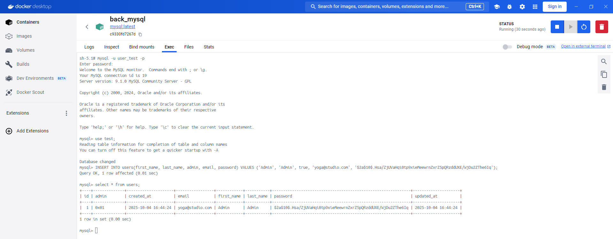

# Yoga App !

Backend de l'application Yoga App !.


## Configuration du back

    - name: back
    - port: 8080

## Pré-requis pour le bon fonctionnement du back :

    -> JDK 21
    -> Docker
    -> Docker Compose
    -> Maven 3.9.3 (https://archive.apache.org/dist/maven/maven-3/3.9.3/binaries/) ou plus

### Utiliser les versions du sujet avec mise

Avec `mise` installé, exécuter depuis `backend/` :

```bash
mise install java@21 maven@3.9.3
mise exec java@21 maven@3.9.3 -- mvn -version
mise exec java@21 maven@3.9.3 -- mvn -B clean verify
```

Ces commandes utilisent Java 21 et Maven 3.9.3 sans changer le Java du système.
`verify` exécute les tests HTTP avec Spring Security, JWT, JPA et une base H2
isolée, ainsi que les tests de validation des jetons et de mapping. Ces tests
ne nécessitent pas Docker et ne modifient pas MySQL. JaCoCo 0.8.12, compatible
Java 21, impose le seuil existant de 90 % des lignes par package ; le rapport
est disponible dans `target/site/jacoco/index.html`.

Les résultats JUnit sont dans `target/surefire-reports/`. H2 ne remplace pas
une validation avec MySQL : vérifier séparément les contraintes SQL et les
parcours contre le serveur réel.

## Responsabilités et erreurs HTTP

Les contrôleurs délèguent les opérations métier aux services. `AuthService`
assure la connexion et l’inscription ; les services vérifient l’existence des
ressources avant lecture ou suppression et la propriété du compte avant sa
suppression. `ArchitectureTest` interdit toute dépendance des contrôleurs vers
les repositories.

`ApiExceptionHandler` traite les identifiants non numériques et les opérations
de participation invalides en 400, les ressources absentes en 404 et le refus
de suppression du compte d’un autre utilisateur en 401, conformément au contrat
existant. Ces réponses ont un corps vide. Les messages JSON d’inscription et
la réponse de connexion sont conservés. Les opérations cohérentes de suppression
et de participation sont transactionnelles.

Ces contrôles ne constituent pas un audit complet des autorisations. Les règles
d’accès aux modifications de séances, l’inscription d’un autre utilisateur,
les contraintes SQL et la suppression d’un compte encore inscrit nécessitent
une vérification distincte.

## Démarrage du back
Pour démarrer le back, il :
- démarrer Docker-Desktop sur votre poste de travail local.
- lancer une console, se placer dans `backend/` et exécuter la commande Maven avec `mise` :
```
mise exec java@21 maven@3.9.3 -- mvn spring-boot:run
```
Cette commande va :
- initialiser le container Docker qui contient la base de données
- lancer l'application back et le connecter à la base de données précédemment créée

### Si les ports habituels sont occupés

Conserver les autres applications et volumes existants. Depuis la racine du
dépôt, démarrer uniquement le MySQL de ce starter et relever son port hôte :

```bash
docker compose --project-directory backend --env-file backend/.env -f backend/compose.yaml config --quiet
docker compose --project-directory backend --env-file backend/.env -f backend/compose.yaml up -d mysql
docker compose --project-directory backend --env-file backend/.env -f backend/compose.yaml port mysql 3306
```

L’accès au socket peut nécessiter les droits Docker de votre environnement.
Ne pas modifier ses permissions pour contourner un refus. Conserver le projet
Compose `backend`, le conteneur `back_mysql` et le volume `backend_db_data`.

Depuis `backend/`, lancer Spring sur un port libre, ici 8082. Dans cet exemple,
remplacer **32768** par le port MySQL relevé, attribué dynamiquement :

```bash
mise exec java@21 maven@3.9.3 -- mvn -B spring-boot:run -Dspring-boot.run.arguments='--server.port=8082 --spring.docker.compose.enabled=false --spring.datasource.url=jdbc:mysql://127.0.0.1:32768/test'
```

L’intégration Compose de Spring est désactivée pour cette exécution parce que
MySQL a déjà été lancé séparément. Les identifiants restent chargés depuis
`backend/.env`. Examiner la cible avant de démarrer : la configuration Hibernate
du starter utilise `ddl-auto: update`.

Pour le frontend, le proxy doit viser le port choisi pour Spring. Sans modifier
la configuration du starter, créer un fichier temporaire hors du dépôt, par
exemple `/tmp/yoga-proxy.json`, contenant :

```json
{
  "/api": {
    "target": "http://127.0.0.1:8082",
    "secure": false,
    "changeOrigin": true,
    "logLevel": "debug"
  }
}
```

Depuis `frontend/`, avec les dépendances installées, lancer Angular sur un
autre port libre :

```bash
npm start -- --host 127.0.0.1 --port 4202 --proxy-config /tmp/yoga-proxy.json
```

Consulter ensuite `http://127.0.0.1:4202`. Une compilation réussie ne suffit
pas : vérifier les requêtes du proxy et les parcours avec la base réelle.
Ne pas supprimer de volume pour résoudre un échec de démarrage.

### Exemple de traces de démarrage

Les traces logs devraient ressemblées à ceci :
```
  .   ____          _            __ _ _
 /\\ / ___'_ __ _ _(_)_ __  __ _ \ \ \ \
( ( )\___ | '_ | '_| | '_ \/ _` | \ \ \ \
 \\/  ___)| |_)| | | | | || (_| |  ) ) ) )
  '  |____| .__|_| |_|_| |_\__, | / / / /
 =========|_|==============|___/=/_/_/_/

 :: Spring Boot ::                (v3.5.5)

[back] [           main] c.o.s.SpringBootSecurityJwtApplication   : Starting SpringBootSecurityJwtApplication using Java 21.0.3 with PID 15152
[back] [           main] c.o.s.SpringBootSecurityJwtApplication   : No active profile set, falling back to 1 default profile: "default"
[back] [           main] .s.b.d.c.l.DockerComposeLifecycleManager : Using Docker Compose file E:\dev\workspaces\missionOC\projet-p4\back\compose.yaml
[back] [utReader-stderr] o.s.boot.docker.compose.core.DockerCli   :  Container back_mysql  Created
[back] [utReader-stderr] o.s.boot.docker.compose.core.DockerCli   :  Container back_mysql  Starting
[back] [utReader-stderr] o.s.boot.docker.compose.core.DockerCli   :  Container back_mysql  Started
[back] [utReader-stderr] o.s.boot.docker.compose.core.DockerCli   :  Container back_mysql  Waiting
[back] [utReader-stderr] o.s.boot.docker.compose.core.DockerCli   :  Container back_mysql  Healthy
[back] [           main] .s.d.r.c.RepositoryConfigurationDelegate : Bootstrapping Spring Data JPA repositories in DEFAULT mode.
[back] [           main] .s.d.r.c.RepositoryConfigurationDelegate : Finished Spring Data repository scanning in 58 ms. Found 3 JPA repository interfaces.
[back] [           main] o.s.b.w.embedded.tomcat.TomcatWebServer  : Tomcat initialized with port 8080 (http)
[back] [           main] o.apache.catalina.core.StandardService   : Starting service [Tomcat]
[back] [           main] o.apache.catalina.core.StandardEngine    : Starting Servlet engine: [Apache Tomcat/10.1.44]
[back] [           main] o.a.c.c.C.[Tomcat].[localhost].[/]       : Initializing Spring embedded WebApplicationContext
[back] [           main] w.s.c.ServletWebServerApplicationContext : Root WebApplicationContext: initialization completed in 1360 ms
[back] [           main] o.hibernate.jpa.internal.util.LogHelper  : HHH000204: Processing PersistenceUnitInfo [name: default]
[back] [           main] org.hibernate.Version                    : HHH000412: Hibernate ORM core version 6.6.26.Final
[back] [           main] o.h.c.internal.RegionFactoryInitiator    : HHH000026: Second-level cache disabled
[back] [           main] o.s.o.j.p.SpringPersistenceUnitInfo      : No LoadTimeWeaver setup: ignoring JPA class transformer
[back] [           main] com.zaxxer.hikari.HikariDataSource       : HikariPool-1 - Starting...
[back] [           main] com.zaxxer.hikari.pool.HikariPool        : HikariPool-1 - Added connection com.mysql.cj.jdbc.ConnectionImpl@16cb6f51
[back] [           main] com.zaxxer.hikari.HikariDataSource       : HikariPool-1 - Start completed.
[back] [           main] org.hibernate.orm.connections.pooling    : HHH10001005: Database info:
	Database JDBC URL [Connecting through datasource 'HikariDataSource (HikariPool-1)']
	Database driver: undefined/unknown
	Database version: 9.1
	Autocommit mode: undefined/unknown
	Isolation level: undefined/unknown
	Minimum pool size: undefined/unknown
	Maximum pool size: undefined/unknown
[back] [           main] o.h.e.t.j.p.i.JtaPlatformInitiator       : HHH000489: No JTA platform available (set 'hibernate.transaction.jta.platform' to enable JTA platform integration)
[back] [           main] j.LocalContainerEntityManagerFactoryBean : Initialized JPA EntityManagerFactory for persistence unit 'default'
[back] [           main] eAuthenticationProviderManagerConfigurer : Global AuthenticationManager configured with AuthenticationProvider bean with name authenticationProvider
[back] [           main] r$InitializeUserDetailsManagerConfigurer : Global AuthenticationManager configured with an AuthenticationProvider bean. UserDetailsService beans will not be used by Spring Security for automatically configuring username/password login. Consider removing the AuthenticationProvider bean. Alternatively, consider using the UserDetailsService in a manually instantiated DaoAuthenticationProvider. If the current configuration is intentional, to turn off this warning, increase the logging level of 'org.springframework.security.config.annotation.authentication.configuration.InitializeUserDetailsBeanManagerConfigurer' to ERROR
[back] [           main] JpaBaseConfiguration$JpaWebConfiguration : spring.jpa.open-in-view is enabled by default. Therefore, database queries may be performed during view rendering. Explicitly configure spring.jpa.open-in-view to disable this warning
[back] [           main] o.s.b.w.embedded.tomcat.TomcatWebServer  : Tomcat started on port 8080 (http) with context path '/'
[back] [           main] c.o.s.SpringBootSecurityJwtApplication   : Started SpringBootSecurityJwtApplication in 10.354 seconds (process running for 11.197)
```

Sur Docker-Desktop, vous devriez voir apparaître un container MySQL qui correspond au projet.


Vous pouvez vous connecter à la base de données et vérifier que la table ```USERS``` a été créée.
Pour cela, cliquez sur le lien `back_mysql` ce qui vous amènera sur la vue complète de la base de données.
Dans l'onglet ```Exec```, il faut :

1. se connecter à la base de données. Tapez la commande ci-dessous

    ```
    mysql -u user_test -p
    ```
   L'invite de commande demandera le mot de passe. Il est : ```test_password```.


2. Se connecter au schéma de base de données `test`. Dans l'invite de commande, tapez la commande ci-dessous :

    ```
    use test;
    ```

3. Copier le contenu du fichier `ressources/sql/insert_user.sql` et l'exécuter dans l'invite de commande :

    ```
    INSERT INTO users(first_name, last_name, admin, email, password) VALUES ('Admin', 'Admin', true, 'yoga@studio.com', '$2a$10$.Hsa/ZjUVaHqi0tp9xieMeewrnZxrZ5pQRzddUXE/WjDu2ZThe6Iq');
    ```
   
3. Vérifier le contenu de la table `users`.

    ```
    select * from users;
    ```
   Le résultat devrait afficher les données de l'utilisateur inséré précédemment.
   
   Ce script crée l'utilisateur admin par défaut :

   - login: yoga@studio.com
   - password: test!1234

La capture d'écran ci-dessous résume les étapes précédentes :




## Ressources


### Collection Postman

Importez la collection Postman

> postman/yoga.postman_collection.json

La documentation de Postman se trouve ici :

https://learning.postman.com/docs/getting-started/importing-and-exporting-data/#importing-data-into-postman
